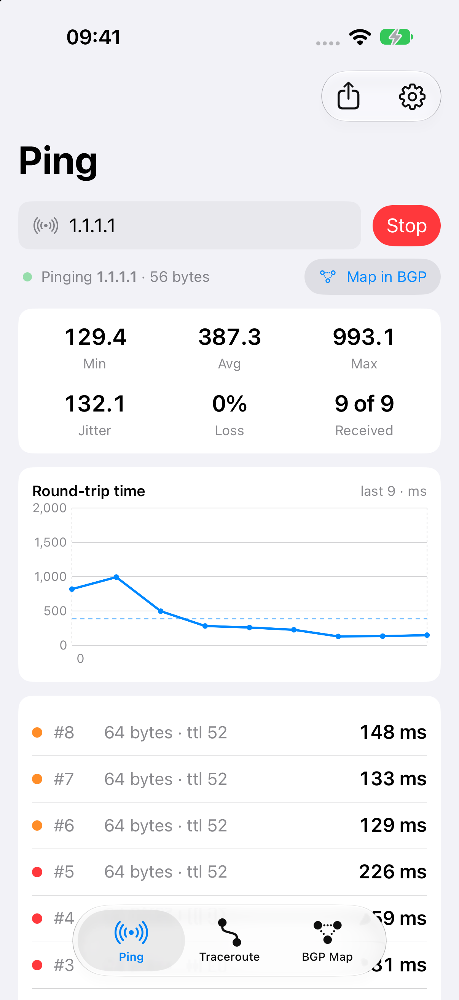
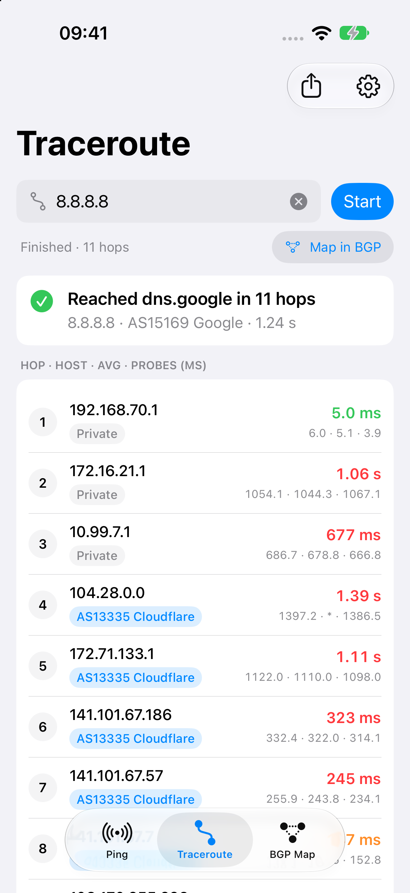
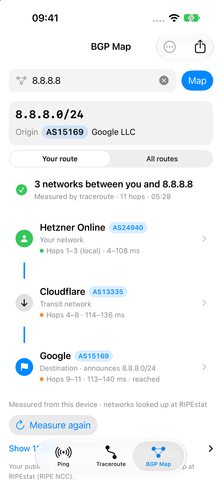
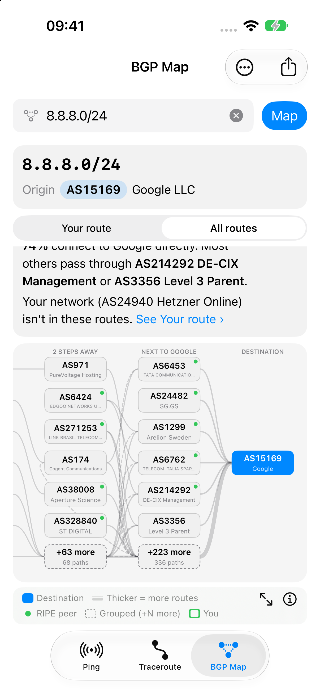

<p align="center">
  
</p>

<h1 align="center">IP Tools: Ping, Traceroute &amp; BGP Map for iPhone and iPad</h1>

<p align="center">
  A free, open-source network toolkit for iOS and iPadOS: <b>ping</b> any IP or hostname, <b>traceroute</b> hop by hop with ASN lookup, and explore a <b>visual BGP map</b> of the AS paths to any IP address, prefix or AS number.
</p>

<p align="center">
  
  
  
  
  
  <a href="https://github.com/ahmadrezaei/ip-tools/actions/workflows/ci.yml"></a>
</p>

<p align="center">
  
  
  
  
</p>

---

**IP Tools** does three things and does them well. It is built for network engineers, sysadmins, NOC and ISP support staff, gamers chasing lag, and anyone curious about how the Internet is wired together.

| Tool | What it does |
|---|---|
| 🛰️ **Ping** | ICMP echo to any IPv4 or IPv6 address or hostname. A live RTT chart, plus min / avg / max, jitter and packet loss. |
| 🧭 **Traceroute** | Hop-by-hop path discovery over IPv4 or IPv6. Each hop shows its response times, reverse DNS hostname and the **ASN / network** that owns it. |
| 🗺️ **BGP Map** | Enter an IP, prefix or ASN to see **Your route**, the chain of networks your traffic crosses, and an interactive graph of the **AS paths** toward the origin AS, built from live routes seen by the **RIPE RIS** route collectors. A BGP looking glass in your pocket. |

## Features

### Ping
- Ping IPv4, IPv6 and hostnames (automatic, IPv4-only or IPv6-only)
- Live round-trip time chart (Swift Charts) with an average line and timeout markers
- Statistics: min, average, max, jitter (mean difference between consecutive replies), packet loss, received count
- **Ping count menu** under the target bar: choose 5, 10, 20, 50, 100, until stopped, or any custom number from 1 to 10,000 (10 by default). It stays in sync with Settings, and the status line shows progress such as "3 of 10"
- Settings for count, interval, timeout and packet size
- Copy or share results as plain text

### Traceroute
- Native ICMP traceroute on the device, with 3 probes per hop and configurable max hops and timeout
- Reverse DNS hostnames for each hop
- **ASN lookup for each hop**: see where your ISP hands off to a transit provider, IXP or CDN
- Private, CGNAT and link-local hops are labelled locally, with no lookup
- From any hop, ping it or map it in the BGP view (your measured trace carries over to **Your route**); share the whole trace as text

### BGP Map (AS path viewer)
- **Your route** (the default view): the networks between you and the target, as a simple chain of ASes. It comes from your own traceroute, or straight from BGP when your network peers with RIPE RIS
- **All routes** (worldwide): the graph described below
- Accepts an **IP address**, **prefix** (e.g. `1.1.1.0/24`) or **AS number** (e.g. `AS13335`, which opens a prefix picker)
- Layered graph with the origin AS on the right, then 1 hop, 2 hops and so on. Edge thickness shows how many paths use each link
- Tap an AS to highlight every path through it. Details include the AS name, role, collectors and sample paths
- Top 6 / 12 / 30 ASes per column, with the rest folded into "+N more"
- Pinch to zoom, drag to pan, and a "fit" button
- An accessible **list view** that is the default when VoiceOver is on
- Data comes from the public [RIPEstat Data API](https://stat.ripe.net/docs/data_api) (`looking-glass`, with an automatic fallback to `bgp-state`)

### Made for iPhone and iPad
- iPhone: three tabs. iPad: a sidebar with tools and recent targets, plus an inspector for AS details
- Keyboard shortcuts on iPad: ⌘1/2/3 to switch tools, ⌘L to focus the target, ⌘R to run, ⌘. to stop, ⌘⇧C to copy results
- Dark Mode, Dynamic Type and VoiceOver

## Privacy

- **No account, no ads, no analytics, no tracking. No data is collected.**
- Ping and traceroute run entirely on your device, using unprivileged ICMP sockets.
- Only BGP Map queries and the ASN lookup for public traceroute hops contact **RIPEstat** (`stat.ripe.net`, run by the RIPE NCC). You can turn the hop lookup off in Settings.
- **Your route** sends your public IP address to RIPEstat to identify your network, and looks up the public router addresses on the way. RIPEstat already sees that address on every request, and the app keeps it in memory only.

Full policy: [PRIVACY.md](PRIVACY.md).

## How it works

- **ICMP without root:** iOS allows `socket(AF_INET, SOCK_DGRAM, IPPROTO_ICMP)` (and the ICMPv6 equivalent) without special entitlements. Traceroute sends echo requests with an increasing `IP_TTL` / `IPV6_UNICAST_HOPS` and reads the routers' *Time Exceeded* replies on the same socket. Replies are matched by identifier, sequence number and a per-run random value.
- **BGP graph:** AS paths are cleaned up (prepends collapsed, loops and AS_SETs handled), placed in columns by distance from the origin AS, ranked by how much transit they carry, and laid out deterministically. See [docs/DESIGN.md §6](docs/DESIGN.md).

## Project structure

```
App/                 Thin iOS app target (entry point, assets, Info.plist, privacy manifest)
IPToolsKit/          Local Swift package — all code and tests
  Sources/NetCore    ICMP codec & socket, Pinger, Tracer, Resolver, IP address parsing
  Sources/RIPEstat   RIPEstat Data API client and models
  Sources/BGPGraph   AS-path graph builder and layered layout
  Sources/SharedUI   Target input bar, state views, formatting, settings
  Sources/PingFeature, TraceFeature, BGPFeature   The three tools
  Sources/AppShell   Root navigation (tabs / split view), router, settings
docs/                Design spec, mockups, icon
```

## Build and run

Requirements: Xcode 16 or later, iOS 17+ SDK. There are no third-party dependencies.

```bash
git clone https://github.com/ahmadrezaei/ip-tools.git
cd ip-tools
open IPTools.xcodeproj
```

Command line:

```bash
scripts/test.sh     # swift test: unit and integration tests for the package
scripts/build.sh    # swift build plus an iOS Simulator build of the app
IPTOOLS_NET_TESTS=1 scripts/test.sh   # also run live ping and traceroute tests against the Internet
```

Most of the code is in the Swift package and also builds on macOS, so `swift test` runs without a simulator.

## FAQ

**Can an iPhone app really do ping and traceroute without jailbreak?**
Yes. iOS supports unprivileged ICMP datagram sockets. IP Tools uses them directly, with no VPN profile, server or proxy.

**Where does the BGP data come from?**
From the RIPE NCC's Routing Information Service (RIS), via the public RIPEstat Data API. RIS route collectors peer with hundreds of networks worldwide, so the map shows how the Internet as a whole reaches a prefix, not just your own ISP.

**Can it show the path my traffic takes?**
Yes. BGP Map's *Your route* view shows the networks between you and the target. It uses a traceroute measured on your device, or, when your network peers with RIPE RIS, the route seen in BGP.

**Can I change how many pings are sent?**
Yes. Use the count menu under the target bar: 5, 10, 20, 50, 100, until stopped, or a custom number from 1 to 10,000.

**Why doesn't traceroute show every hop?**
Some routers don't answer ICMP or rate-limit it. Those hops show `* * *`, just as the command-line `traceroute` does.

**Does it support IPv6?**
Yes. Ping, traceroute and the BGP map all work with IPv6 addresses and prefixes.

## Contributing

Issues and pull requests are welcome. Please keep the app focused on its three tools. The design and architecture are in [docs/DESIGN.md](docs/DESIGN.md), and the approved UI mockups are in [docs/mockup.html](docs/mockup.html).

## License

[MIT](LICENSE) © 2026 Ahmad Rezaei

BGP data © RIPE NCC, provided through [RIPEstat](https://stat.ripe.net/).

---

<sub>Keywords: ping app for iPhone, ping count, my route to a server, network path viewer, traceroute iOS, iPad network tools, BGP looking glass, AS path viewer, ASN lookup, IP tools, network diagnostic app, ICMP ping, IPv6 traceroute, RIPEstat, RIPE RIS, open-source iOS network utility, SwiftUI networking app.</sub>
